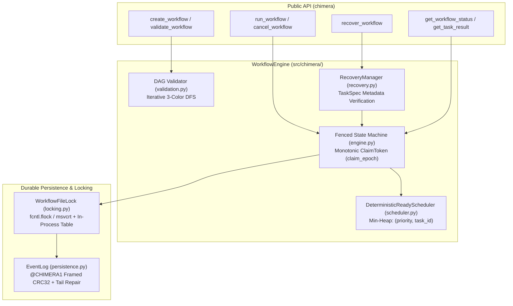
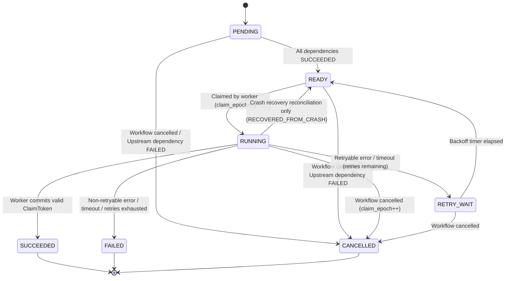

# CHIMERA — Fault-Tolerant DAG Workflow Engine

CHIMERA is a zero-dependency, crash-recoverable Directed Acyclic Graph (DAG) workflow orchestration engine written in pure Python (`3.11+` standard library only). It is designed to demonstrate rigorous systems engineering practices: event-sourced persistence, CRC32-framed log records, monotonic fencing tokens, cross-process advisory file locking, and deterministic adversarial testing without `time.sleep`.

> **Development Transparency Note**: AI coding and reasoning tools assisted in the design, implementation, adversarial auditing, and documentation of this project. All tests and verification outputs reported below were genuinely executed in the build environment.

## Problem Statement & Design Goals

In-process task runners often fail silently under concurrency and crash conditions: a timed-out worker thread finishes late and overwrites a retry's result, an abrupt crash mid-write leaves a half-written JSON line that breaks recovery, or two processes open the same state file and interleave corrupt records.

CHIMERA addresses these failure modes within a compact, inspectable standard-library architecture:
- **Strict DAG Validation**: Rejects duplicate task IDs, missing dependencies, and arbitrarily deep dependency cycles (via iterative 3-color DFS with exact cycle-path reporting) before execution begins.
- **Event-Sourced State Machine**: Every task and workflow state transition is durably written and `fsync`ed to an append-only framed event log before updating in-memory state.
- **Monotonic Fencing (`ClaimToken`)**: Every worker claim increments a monotonic `claim_epoch`. Completions from timed-out, cancelled, or superseded workers are deterministically rejected (`STALE_COMPLETION_IGNORED`).
- **Distinguishing Tail Truncation from Interior Corruption**: Repairs incomplete trailing records caused by mid-write crashes (`os.ftruncate` + `os.fsync`) while raising `LogCorruptionError` on any interior bit-flip, framing error, sequence gap, or illegal state transition.

## Feature Matrix: Implemented vs. Planned

| Capability | Status | Implementation Details |
| :--- | :--- | :--- |
| Dependency-aware DAG validation & cycle detection | **Implemented** | Iterative 3-color DFS (`validate_dag`) with exact cycle path in `CycleDetectedError`. |
| Bounded concurrent task execution | **Implemented** | Thread-based worker dispatch (`max_concurrency`) with deterministic `(priority, task_id)` ordering. |
| Task retries, exponential backoff & exception filtering | **Implemented** | Configurable `max_retries`, `base_backoff_seconds`, `backoff_factor`, `max_backoff_seconds`, `retryable_exceptions`. |
| Task timeouts with stale-worker fencing | **Implemented** | Deadline watchdog + monotonic `ClaimToken` fencing + replacement worker spawning. |
| Framed CRC32 append-only event log & tail repair | **Implemented** | `@CHIMERA1\|<seq>\|<len>\|<crc32>\|<json>\n` framing in `EventLog`. |
| Crash recovery & `TaskSpec` compatibility validation | **Implemented** | `recover_workflow()` verifies persisted `TaskSpec` metadata and never re-runs committed `SUCCEEDED` tasks. |
| Cross-process & in-process file locking | **Implemented** | `WorkflowFileLock` (`fcntl.flock` on POSIX, `msvcrt.locking` on Windows, plus in-process canonical path guard). |
| Preemptive OS kill of wedged C-extension threads | **Planned** | Requires switching worker execution from `threading.Thread` to `multiprocessing` child processes. |
| Distributed multi-node execution | **Planned** | Single-host engine only; distributed execution would require a consensus log or external broker. |

## Architecture Overview



### Task State Machine



## Installation

CHIMERA requires **Python 3.11 or newer** and uses only the Python standard library.

### Linux / macOS
```bash
git clone https://github.com/your-username/chimera.git
cd chimera
python3 -m venv .venv
source .venv/bin/activate
pip install -e .
```

### Windows (PowerShell)
```powershell
git clone https://github.com/your-username/chimera.git
cd chimera
python -m venv .venv
.\.venv\Scripts\Activate.ps1
pip install -e .
```

You can also run all tests and examples directly from a clean checkout without installing via `pip`:
```bash
python3 scripts/run_tests.py
```

## Usage Examples

### 1. Minimal Diamond DAG Workflow (`examples/basic_workflow.py`)
```python
import tempfile
from chimera import (
    TaskSpec,
    create_workflow,
    get_task_result,
    run_workflow,
    validate_workflow,
)

with tempfile.TemporaryDirectory() as tmpdir:
    tasks = [
        TaskSpec(
            task_id="extract_orders",
            input_payload={"records": [100, 250, 400]},
            func=lambda payload: [x for x in payload["records"] if x >= 150],
        ),
        TaskSpec(
            task_id="compute_subtotal",
            dependencies=["extract_orders"],
            func=lambda _p, ctx: sum(ctx.dependency_results["extract_orders"]),
        ),
        TaskSpec(
            task_id="compute_tax",
            dependencies=["extract_orders"],
            input_payload={"tax_rate": 0.08},
            func=lambda payload, ctx: round(
                sum(ctx.dependency_results["extract_orders"]) * payload["tax_rate"], 2
            ),
        ),
        TaskSpec(
            task_id="generate_invoice",
            dependencies=["compute_subtotal", "compute_tax"],
            func=lambda _p, ctx: {
                "subtotal": ctx.dependency_results["compute_subtotal"],
                "tax": ctx.dependency_results["compute_tax"],
                "total": ctx.dependency_results["compute_subtotal"]
                + ctx.dependency_results["compute_tax"],
            },
        ),
    ]

    wf = create_workflow(tasks, max_concurrency=2, workflow_id="wf_basic_demo", storage_dir=tmpdir)
    validate_workflow(wf)
    summary = run_workflow(wf)
    invoice = get_task_result(wf.workflow_id, "generate_invoice")
    print(summary.status.value, invoice.result)
    # Output: SUCCEEDED {'subtotal': 650, 'tax': 52.0, 'total': 702.0}
```

### 2. Retries with Exponential Backoff (`examples/retry_example.py`)
```bash
python3 examples/retry_example.py
# Output: [retry_example] status=SUCCEEDED attempts=3 backoff_offsets_sec=[0.0, 0.5, 1.5] result={'status': 200, 'attempt': 3}
```

### 3. Crash Recovery from a Truncated Final Log Record (`examples/recovery_example.py`)
```bash
python3 examples/recovery_example.py
# Output:
# [recovery_example] Caught expected crash: Simulated power failure mid-write after step_1 SUCCEEDED
# [recovery_example] Counts before recovery: {'step_1': 1, 'step_2': 0}
# [recovery_example] Recovered status=SUCCEEDED tail_repaired=True counts_after={'step_1': 1, 'step_2': 1} output='checkpoint_alpha -> completed_step_2'
```

## Running the Test Suite & Actual Verification Output

Run the complete compilation and test suite with:
```bash
python3 scripts/run_tests.py
```
Or run `unittest` directly:
```bash
PYTHONPATH=src python3 -m unittest discover -s tests -p "test_*.py" -v
```

### Actual Test Execution Output (Python 3.11.2)
```text
[check] Bytecode compilation succeeded for 22 Python files.
test_hidden_1_two_independent_processes_opening_same_workflow_log_concurrently (test_adversarial.TestChimeraAdversarialSuite.test_hidden_1_two_independent_processes_opening_same_workflow_log_concurrently) ... ok
test_hidden_2_crash_during_partial_event_log_write (test_adversarial.TestChimeraAdversarialSuite.test_hidden_2_crash_during_partial_event_log_write) ... ok
test_hidden_3_crash_after_external_file_side_effect_before_durable_success (test_adversarial.TestChimeraAdversarialSuite.test_hidden_3_crash_after_external_file_side_effect_before_durable_success) ... ok
test_hidden_4_stale_worker_completes_while_retry_running_and_exits_pool (test_adversarial.TestChimeraAdversarialSuite.test_hidden_4_stale_worker_completes_while_retry_running_and_exits_pool) ... ok
test_hidden_5_cancellation_racing_with_successful_completion (test_adversarial.TestChimeraAdversarialSuite.test_hidden_5_cancellation_racing_with_successful_completion) ... ok
test_hidden_6_corrupted_records_followed_by_apparently_valid_records (test_adversarial.TestChimeraAdversarialSuite.test_hidden_6_corrupted_records_followed_by_apparently_valid_records) ... ok
test_hidden_7_recovery_with_altered_task_definitions_or_dependency_graphs (test_adversarial.TestChimeraAdversarialSuite.test_hidden_7_recovery_with_altered_task_definitions_or_dependency_graphs) ... ok
test_scenario_A_diamond_dag_concurrent_branches (test_adversarial.TestChimeraAdversarialSuite.test_scenario_A_diamond_dag_concurrent_branches) ... ok
test_scenario_B_deep_dependency_cycle_and_validation (test_adversarial.TestChimeraAdversarialSuite.test_scenario_B_deep_dependency_cycle_and_validation) ... ok
test_scenario_C_crash_after_side_effect_before_commit (test_adversarial.TestChimeraAdversarialSuite.test_scenario_C_crash_after_side_effect_before_commit) ... ok
test_scenario_D_restart_after_durable_success_never_reruns (test_adversarial.TestChimeraAdversarialSuite.test_scenario_D_restart_after_durable_success_never_reruns) ... ok
test_scenario_E_concurrent_workers_claim_same_task (test_adversarial.TestChimeraAdversarialSuite.test_scenario_E_concurrent_workers_claim_same_task) ... ok
test_scenario_F_task_timeout_with_background_worker (test_adversarial.TestChimeraAdversarialSuite.test_scenario_F_task_timeout_with_background_worker) ... ok
test_scenario_G_dependency_fails_after_retries_cascades_downstream (test_adversarial.TestChimeraAdversarialSuite.test_scenario_G_dependency_fails_after_retries_cascades_downstream) ... ok
test_scenario_H_truncated_final_event_log_record_recovery (test_adversarial.TestChimeraAdversarialSuite.test_scenario_H_truncated_final_event_log_record_recovery) ... ok
test_scenario_I_earlier_event_log_record_corrupted (test_adversarial.TestChimeraAdversarialSuite.test_scenario_I_earlier_event_log_record_corrupted) ... ok
test_scenario_J_simultaneous_completion_and_cancellation (test_adversarial.TestChimeraAdversarialSuite.test_scenario_J_simultaneous_completion_and_cancellation) ... ok
test_scenario_K_retryable_error_then_success (test_adversarial.TestChimeraAdversarialSuite.test_scenario_K_retryable_error_then_success) ... ok
test_scenario_L_stale_completion_after_superseded_by_retry (test_adversarial.TestChimeraAdversarialSuite.test_scenario_L_stale_completion_after_superseded_by_retry) ... ok
test_scenario_M_exhaustive_crash_between_every_persistence_operation (test_adversarial.TestChimeraAdversarialSuite.test_scenario_M_exhaustive_crash_between_every_persistence_operation) ... ok
test_scenario_N_empty_and_single_task_workflows (test_adversarial.TestChimeraAdversarialSuite.test_scenario_N_empty_and_single_task_workflows) ... ok
test_scenario_O_payload_and_dependency_result_isolation (test_adversarial.TestChimeraAdversarialSuite.test_scenario_O_payload_and_dependency_result_isolation) ... ok
test_cancel_before_run_cancels_all_tasks (test_cancellation.TestWorkflowCancellation.test_cancel_before_run_cancels_all_tasks) ... ok
test_cancellation_racing_with_completion_and_late_cancellation (test_cancellation.TestWorkflowCancellation.test_cancellation_racing_with_completion_and_late_cancellation) ... ok
test_cross_process_and_in_process_lock_contention (test_concurrency.TestConcurrencyAndIsolation.test_cross_process_and_in_process_lock_contention) ... ok
test_payload_and_dependency_result_deep_copy_isolation (test_concurrency.TestConcurrencyAndIsolation.test_payload_and_dependency_result_deep_copy_isolation) ... ok
test_simultaneous_worker_claim_exclusion (test_concurrency.TestConcurrencyAndIsolation.test_simultaneous_worker_claim_exclusion) ... ok
test_exponential_backoff_computation_and_cap (test_models.TestModelsAndValidation.test_exponential_backoff_computation_and_cap) ... ok
test_invalid_task_spec_parameters_rejected (test_models.TestModelsAndValidation.test_invalid_task_spec_parameters_rejected) ... ok
test_invalid_workflow_max_concurrency_rejected (test_models.TestModelsAndValidation.test_invalid_workflow_max_concurrency_rejected) ... ok
test_task_context_cancellation_signaling (test_models.TestModelsAndValidation.test_task_context_cancellation_signaling) ... ok
test_unknown_task_result_lookup_raises_key_error (test_models.TestModelsAndValidation.test_unknown_task_result_lookup_raises_key_error) ... ok
test_virtual_clock_monotonicity_enforcement (test_models.TestModelsAndValidation.test_virtual_clock_monotonicity_enforcement) ... ok
test_corrupted_interior_records_raise_log_corruption_error (test_persistence.TestPersistenceAndLogIntegrity.test_corrupted_interior_records_raise_log_corruption_error) ... ok
test_partial_write_crash_on_seq_1_and_subsequent_records (test_persistence.TestPersistenceAndLogIntegrity.test_partial_write_crash_on_seq_1_and_subsequent_records) ... ok
test_semantic_corruption_with_valid_crc_raises_corrupted_transition_error (test_persistence.TestPersistenceAndLogIntegrity.test_semantic_corruption_with_valid_crc_raises_corrupted_transition_error) ... ok
test_windows_o_binary_flag_enforced_on_all_os_open_calls (test_persistence.TestPersistenceAndLogIntegrity.test_windows_o_binary_flag_enforced_on_all_os_open_calls) ... ok
test_committed_tasks_never_rerun_and_repeated_recovery_is_idempotent (test_recovery.TestWorkflowRecovery.test_committed_tasks_never_rerun_and_repeated_recovery_is_idempotent) ... ok
test_recovery_rejects_altered_task_specs_or_dependencies (test_recovery.TestWorkflowRecovery.test_recovery_rejects_altered_task_specs_or_dependencies) ... ok
test_deterministic_priority_and_lexicographical_tie_breaking (test_scheduler.TestSchedulerAndDAGValidation.test_deterministic_priority_and_lexicographical_tie_breaking) ... ok
test_diamond_dag_concurrent_execution_and_join (test_scheduler.TestSchedulerAndDAGValidation.test_diamond_dag_concurrent_execution_and_join) ... ok
test_failed_task_exhausting_retries_blocks_all_downstream_tasks (test_scheduler.TestSchedulerAndDAGValidation.test_failed_task_exhausting_retries_blocks_all_downstream_tasks) ... ok
test_rejects_duplicate_ids_missing_deps_and_deep_cycles (test_scheduler.TestSchedulerAndDAGValidation.test_rejects_duplicate_ids_missing_deps_and_deep_cycles) ... ok

----------------------------------------------------------------------
Ran 43 tests in 0.968s

OK
```

## Known Limitations & Concurrency Guarantees

1. **External Side-Effect vs. Local Commit Gap**: If a worker process crashes after performing an external side effect (e.g., an HTTP POST or file write) but before `SUCCEEDED` is `fsync`ed to `<workflow_id>.chimera.log`, recovery resets the task to `READY` and re-executes it. Use `ctx.idempotency_key` (`<workflow_id>:<task_id>`) to deduplicate external side effects.
2. **Thread-Based Worker Model**: Because Python threads cannot be safely killed by the OS mid-execution, a timed-out task is fenced off via `ClaimToken.claim_epoch` and a replacement worker is spawned, while cooperative tasks can inspect `ctx.is_cancelled()`.
3. **JSON Payload Persistence**: Payloads and task results persisted to the event log must be JSON-serializable for lossless cross-process recovery.
4. **Filesystem Locking**: Cross-process locking uses `fcntl.flock` on POSIX and `msvcrt.locking` on Windows; network filesystems that do not support advisory locks are not supported.

See [`docs/limitations.md`](docs/limitations.md) and [`docs/architecture.md`](docs/architecture.md) for full details.

## Security Considerations

- **No `pickle` or Arbitrary Code Execution**: Persistence uses strict ASCII JSON (`ensure_ascii=True`) with CRC32 frame verification.
- See [`SECURITY.md`](SECURITY.md) for storage directory permission guidance.

## Project Structure

```text
chimera/
├── README.md
├── LICENSE
├── pyproject.toml
├── requirements.txt
├── .gitignore
├── CHANGELOG.md
├── CONTRIBUTING.md
├── SECURITY.md
├── src/
│   └── chimera/
│       ├── __init__.py
│       ├── clock.py
│       ├── engine.py
│       ├── exceptions.py
│       ├── locking.py
│       ├── models.py
│       ├── persistence.py
│       ├── recovery.py
│       ├── scheduler.py
│       └── validation.py
├── tests/
│   ├── __init__.py
│   ├── test_adversarial.py
│   ├── test_cancellation.py
│   ├── test_concurrency.py
│   ├── test_models.py
│   ├── test_persistence.py
│   ├── test_recovery.py
│   └── test_scheduler.py
├── examples/
│   ├── basic_workflow.py
│   ├── recovery_example.py
│   └── retry_example.py
├── docs/
│   ├── architecture.md
│   ├── design_decisions.md
│   ├── limitations.md
│   └── testing.md
└── scripts/
    └── run_tests.py
```

## Contributing & License

Contributions are welcome! Please read [`CONTRIBUTING.md`](CONTRIBUTING.md) before opening a pull request. Distributed under the [MIT License](LICENSE).
